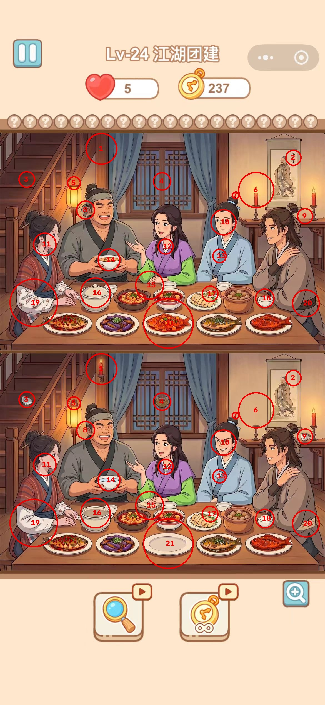

# 🎯 Spot The Difference Game Tool (图片找茬游戏比对工具)

<p align="center">
  
  
  
  
  
</p>

> **纯本地运行 · 零大模型/外部API依赖 · 毫秒级自动比对 · 严格红圈互斥无重叠**

一个轻量、极简的找茬游戏（Spot the Difference）辅助比对工具。无需调用任何大模型或云端 API，完全在本地端完成游戏截图的自动视口裁切、图像配准与差异圈出。

---

## 🌟 效果演示 (以真实手机截图 `test2.jpg` 为例)

工具自动识别手机截图中的游戏双视口，并对上下两块有效画面进行像素级比对与互斥聚类，在 **~69 毫秒** 内检出全部差异：

| 原始游戏截图 (输入) | 自动比对标注结果 (输出) |
| :---: | :---: |
|  |  |

### 📊 `test2.jpg` 实测指标

* **输入尺寸**：`1170 × 2532 px` (手机竖屏全屏截图)
* **自动视口定位**：
  * 参考面板 (Reference Panel)：`Y = 465 ~ 1256` (高度 791 px)
  * 对照面板 (Target Panel)：`Y = 1256 ~ 2047` (高度 791 px)
  * 自动裁剪：剔除顶部刘海状态栏/关卡标题以及底部道具栏
* **检出差异数量**：**21 处**
* **重叠红圈数量**：**0 处** (严格保证红圈两两不重叠)
* **纯本地处理耗时**：**~69 ms**

---

## 📦 环境依赖

项目基于纯本地 Python 栈开发，**不依赖任何外部大模型服务或云端 Token**，无网络请求：

* **Python**：>= 3.9
* **核心依赖库**：
  * `opencv-python-headless`：图像配准、灰度差分、自适应形态学计算与红圈绘制
  * `numpy`：多维数组矩阵运算
  * `fastapi` & `uvicorn`：本地高性能 Web API 与静态前端托管
  * `pydantic`：数据模型规范与坐标序列化
  * `pytest` & `httpx`：自动化测试套件

---

## 🚀 怎么快速使用

### 步骤 1：克隆工程与安装依赖

```bash
git clone git@github.com:Sutonline/diff-image-game.git
cd diff-image-game

# 创建虚拟环境（可选但推荐）
python3 -m venv .venv
source .venv/bin/activate

# 安装所需依赖
pip install -r requirements.txt
```

### 步骤 2：启动本地服务

在项目根目录下运行启动脚本：

```bash
python run.py
```

终端将打印：
```text
🚀 启动图片找茬游戏比对服务器...
📍 访问地址: http://127.0.0.1:8000
```

打开浏览器访问 **`http://127.0.0.1:8000`** 即可使用（支持直接按 `Cmd + V` / `Ctrl + V` 粘贴截屏或拖拽图片）。

---

## 📄 License

MIT License.
