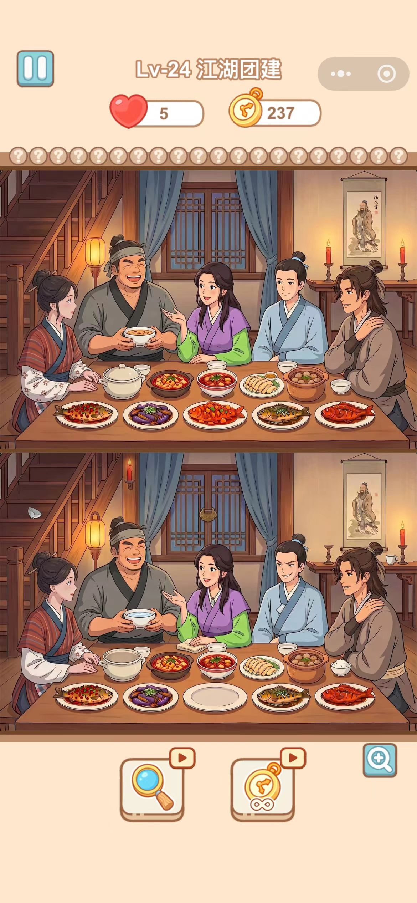

# 🎯 Spot The Difference Game Tool (图片找茬游戏比对工具)

<p align="center">
  
  
  
  
  
</p>

> **纯本地运行 · 零大模型/外部 API 依赖 · 自动读取关卡差异数量 · 第二轮只圈剩余差异**

一个轻量的找茬游戏（Spot the Difference）辅助工具，提供两种用法：

* **网页版**：上传或粘贴截图，自动圈出差异；
* **微信小游戏原位 HUD（macOS）**：直接在电脑版微信的小游戏窗口上方投射透明红圈，点击穿透，可以对着红圈直接点。

全部计算在本地完成，不调用任何大模型或云端 API。

---

## 🌟 效果演示（以 `assets/demo_original.jpg` 为例）

| 原始游戏截图（输入） | 自动比对标注结果（输出） |
| :---: | :---: |
|  |  |

* **输入尺寸**：`1170 × 2532 px`（手机竖屏全屏截图）
* **自动视口定位**：上图 `Y = 479 ~ 1235`，下图 `Y = 1269 ~ 2025`，自动剔除顶部标题栏和底部道具栏
* **关卡差异数量**：从顶部问号栏自动读出 **20 处**
* **检出差异**：**20 处**，逐一核对均为真实差异

---

## 📦 环境依赖

* **Python** >= 3.9
* `opencv-python-headless`：图像配准、色差计算、形态学与连通域分析
* `numpy`：矩阵运算
* `fastapi` & `uvicorn`：本地 Web API 与静态前端（网页版）
* `pydantic`：数据模型
* `pytest` & `httpx`：自动化测试
* HUD 模式额外需要 macOS 自带的 `swiftc` / `clang`（首次运行时自动编译透明悬浮窗和窗口查找组件）

```bash
git clone git@github.com:Sutonline/diff-image-game.git
cd diff-image-game
python3 -m venv .venv
source .venv/bin/activate
pip install -r requirements.txt
```

---

## 🚀 使用方法

### 方式一：网页版

```bash
python run.py
```

打开 **`http://127.0.0.1:8000`**，拖入图片，或按 `Cmd + V` / `Ctrl + V` 粘贴截图。

### 方式二：微信小游戏原位 HUD（macOS）

先在电脑版微信里打开找茬小游戏，进入关卡，然后运行：

```bash
python run_hud.py
```

程序会自动找到小游戏窗口、截图、识别，并把红圈直接画在游戏画面上（点击穿透，可以对着红圈点击；按 ESC 关闭红圈）。

**推荐玩法（两轮）：**

1. **第一轮**：进入新关卡后按 **回车**，照着红圈点。
2. **第二轮补漏**：点完后如果顶部还有 `?`，再按一次 **回车**。程序会识别游戏画的**绿圈**（已找到的差异），把它们全部跳过，**只圈出剩余没找到的差异**。
3. **换一个**：第二轮里如果点了红圈游戏不认，输入 **`n`** 回车，程序会排除这个位置，给出下一个候选，可以连续使用。

**终端快捷指令：**

| 输入 | 作用 |
| :--- | :--- |
| 回车 | 截图并识别当前关卡（第二轮自动跳过绿圈） |
| `n` | 跳过当前红圈、换下一个候选（画面上不超过 3 个红圈时可用） |
| `+5` / `-5` | 在自动数量基础上增加或减少圈数 |
| `20` 等数字 | 强制指定本关差异数量 |
| `r` | 重置数量设置 |
| `f` / `a` | 切换固定框位 / 自动识别框位 |
| `q` | 退出 |

常用启动参数：`--timeout` 红圈显示时长（默认 15 秒），`--threshold` 色差阈值（默认 18），`--min-area` 最小面积（默认 12），`--no-click-through` 关闭点击穿透。

---

## 🔍 识别流程

核心代码在 `diff_game/engine.py`，一次识别依次经过以下步骤：

1. **定位上下两张图**：用上下周期相关匹配找出两张图的位置，剔除标题栏、按钮等界面元素。
2. **读取关卡信息**：识别顶部徽章行，得到"本关共几处、已打勾几处"。
3. **识别已找到的差异**：在画面中寻找游戏画的绿圈。判断依据是：颜色为游戏专用的黄绿色、是一条细环带（草地、树叶等成片绿色会被形态学开运算去掉）、能紧密拟合成一个圆，且沿圆周一圈几乎全是绿色。识别出的绿圈不多于打勾数量（最多允许多 1 个）时才采用，否则当作没有绿圈处理。
4. **亚像素对齐**：缩放后的窗口里，上下两张图常有不到 1 像素的错位。用 ECC 估计近似恒等的仿射变换，把下图对齐到上图。
5. **容错色差**：统一缩放到 600 px 宽，计算 LAB 色差（ΔE），并允许 ±1 像素的容差：只有附近 1 像素内都找不到相同颜色，才算"不同"。这样能消除线条边缘抖动，又保留真正增减的物体。
6. **成块与过滤**：二值化、开运算去噪、膨胀把同一物体的碎片连起来，再做连通域分析。之后过滤三类假差异：细长线条（灯带、桌沿等错位造成的残影）、绿圈内部、紧贴绿圈外侧的小块（已找到差异露在圈外的部分）。
7. **形状补位**：颜色比较找到的候选不够数时，在原始分辨率下比较局部笔画形状（带对比度权重的归一化互相关），找出"颜色不变、形状变了"的差异，例如对联上改了一个字。
8. **数量收敛**：
   * 候选太多：先合并紧挨着的碎块，再丢掉明显的弱噪点，最后合并距离最近、合并后仍是物体大小的两块；
   * 候选太少：先用形状补位，再逐步降低颜色阈值。

---

## 🧪 测试

```bash
pytest
```

`tests/fixtures/` 中保存了曾经识别出错的真实关卡截图，每一张都作为回归测试，保证以后的修改不会让它们再次出错：

| 截图 | 关卡状态 | 验证内容 |
| :--- | :--- | :--- |
| `assets/demo_original.jpg` | 新关卡，0 / 20 | 20 处全部圈出 |
| `tests/fixtures/lv60_window.png` | 已找到 4 / 20 | 亚像素错位不产生巨圈；跳过 4 个绿圈，圈出剩余 16 处 |
| `tests/fixtures/lv64_window.png` | 已找到 19 / 20 | 天花板灯带不误报；找出低对比度的音箱 |
| `tests/fixtures/lv74_window_hud.png` | 已找到 14 / 15 | 不圈露在绿圈外的边角；找出对联上"好 → 坏"一个字的差异 |

---

## 📜 修改策略历史

这个项目在识别准确度上经历了多轮修改。下面记录每一轮遇到的问题、原因和应对策略，供以后继续修改时参考。

### 第 0 轮：诊断（修改前的状态）

此前已经连续修改了十多次，结果仍然不对。用 demo 截图验证：关卡共 20 处，程序圈出 26 处。原因不在某个参数，而在方法本身：

* **一处差异被拆成多个圈**：每个差异小块画固定半径 16 px 的圈，相距 28 px 以内才合并。袖子花纹这样的一处差异被拆成六七个圈。
* **所有阈值都是绝对像素值**：合并距离、半径、最小面积都没有按分辨率换算。电脑窗口截图（约 700 px 宽）和手机截图（1170 px 宽）上，同一个数字效果完全不同。
* **读问号数量的功能有 bug**：拿直方图的区间中心当这一排问号的高度，偏差约 10 px，结果全部被过滤掉，"按问号数量限制圈数"从来没有生效过。
* **圈多了就按显著度直接删**：可能删掉真差异，却留下碎圈。
* **修改方式是打补丁**：每次针对某一关的某个物体（手表、台灯）加一条特殊规则，没有回归测试，结果按下葫芦浮起瓢。

### 第 1 轮：重写检测核心

* 统一缩放到 600 px 宽再检测，所有参数都基于这个尺寸。
* 改用 LAB 色差，再用膨胀把同一物体的碎片连成一块，圈的大小跟着差异的范围走。
* 修复问号数量识别。
* 圈数多于问号数时，改为合并距离最近的两块，而不是删除。
* 加入真实截图回归测试。

### 第 2 轮：Lv-60，亚像素错位

* **现象**：圈出一个横跨整幅画面的巨圈，真差异被淹没。
* **原因**：窗口缩放后，上下两张图错开约 0.4 像素，整数像素对齐无法消除，画面中所有线条边缘都被当成了差异，"合并最近的块"又把它们连成了一整片。
* **策略**：用 ECC 做亚像素对齐，并采用 ±1 像素容错的对称色差。数量收敛时先丢弃能量不到中位数 10% 的噪点，合并后的范围不能超过画面的 30%，圈的半径也设上限。

### 第 3 轮：Lv-64，细线误报与低对比度漏检

* **现象**：天花板上多圈了两个，墙上的深色音箱没有圈出来。
* **原因**：灯带边缘 1～2 像素粗的细横线有微小错位，被当成差异；音箱差异很淡，数量收敛时被当作噪点丢掉，而女生脸上被拆成两块的同一处差异却占了两个名额。
* **策略**：过滤又细又长的线条（粗不超过 3 px、长宽比 ≥ 4）；数量收敛时，先合并紧挨着的碎块（间距 ≤ 3 px），再判断哪些是噪点。

### 第 4 轮：Lv-67，程序的分组和游戏答案不一致

* **现象**：右下角的花篮在游戏里算一处，程序却拆成了两个圈（提手和篮身），多占的名额把真正剩下的那处（扑克花色 ♠ → ♣）挤掉了。
* **分析**：哪些碎块算同一处，只有游戏的答案知道，光看画面无法百分之百判断。调整合并规则只能减少这种情况，不能杜绝。
* **策略：第二轮补漏**。游戏会在玩家找到的地方画绿圈，绿圈的大小就是游戏对"一处"的定义。点完一轮后再识别一次：区分顶部哪些徽章已打勾、哪些还是 `?`；找出画面里的绿圈，绿圈以内全部跳过；只按剩余 `?` 的数量去找。绿圈是玩家点击后才出现的，所以第一轮不受影响；识别绿圈不依赖截图里的白边，只靠颜色、细环带形状和圆周拟合；识别出的绿圈明显多于打勾数时不采用，避免误认导致漏圈。

### 第 5 轮：Lv-74（一），已找到差异露在绿圈外

* **现象**：第二轮圈出的唯一候选，游戏不认。
* **原因**：大绿圈里那处差异是长条形的，游戏的绿圈没有把它的顶端全部包进去，露在圈外的一小截被当成了"剩下的那处"。
* **策略**：紧贴绿圈外侧（距离不超过约 0.35 倍半径 + 4 px）的小块，算作这个绿圈的一部分。同时新增 `n` 指令：游戏不认的候选可以手动跳过，程序给出下一个。这是应对各种无法预料的误导的通用兜底。

### 第 6 轮：Lv-74（二），只改了一个字

* **现象**：真正剩下的差异是对联上"好男人"变成"坏男人"，程序找不到。
* **原因**：两个字都是黑墨写在米色纸上，颜色完全一样，只有偏旁的几笔不同；缩小到 600 px 后，一个字只有十几个像素，这几笔被抹平了。
* **策略**：新增"形状补位"。在原始分辨率下，用带对比度权重的归一化互相关比较局部笔画结构。这种方法单独使用时，在地毯纹理等地方也会误报，所以只在颜色比较找到的候选不够数时才启用，排在降低颜色阈值之前。

### 经验总结

1. **不针对单个物体调参。** 遇到新问题先找出根本原因，再改通用规则。
2. **每张出过错的截图都加入回归测试。** 所有截图都通过，才算改好。
3. **数量对不上时，优先合并或补位，不要直接删除。** 直接删除最容易删掉真差异。
4. **充分利用游戏自己给的信号**：问号数量、打勾状态、绿圈大小，都比程序自己的推测更可靠。
5. **给用户留兜底手段。** 识别不可能百分之百准确，`n`（换一个）、`+N/-N`（调整数量）让用户在出错时仍能继续玩下去。

### 已知限制

* **第一轮仍可能分组不一致**：同一处差异被拆开，或两处被合成一处。第一轮还没有绿圈可以参考，需要靠第二轮补漏解决。
* **形状补位已接近方法的极限**：在低分辨率截图上，"只改一个字"这类差异和背景纹理的得分差距不大。
* **草地多的关卡**：绿圈识别只验证了"草地不会被误认成绿圈"，还没有在干净截图上验证过绿圈本身能否被正确认出。
* **`lv74_window_hud.png` 是带 HUD 红圈截的图**：两张图的标签区域已经处理成一致，但不如干净截图理想。

---

## 📄 License

MIT License.
